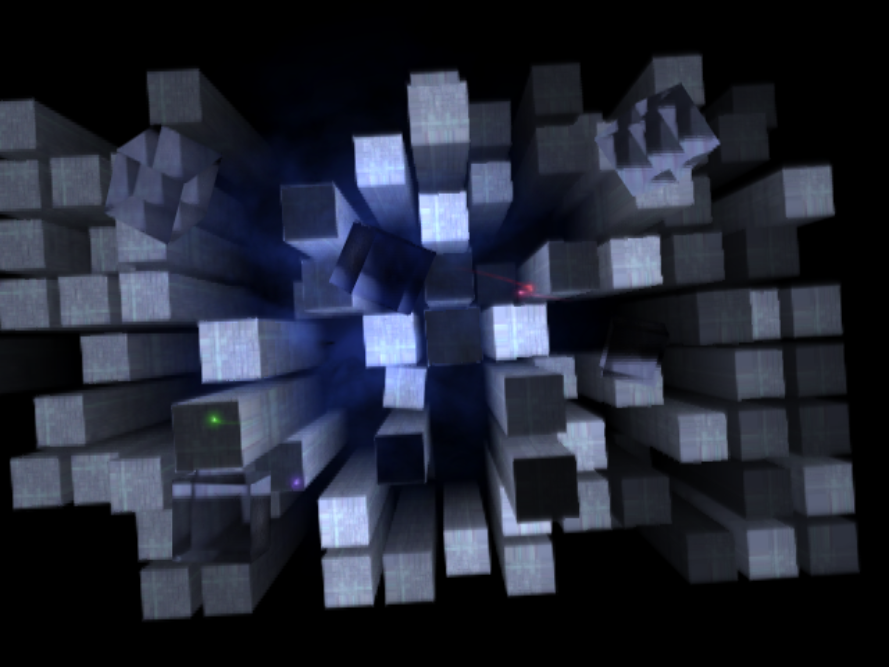
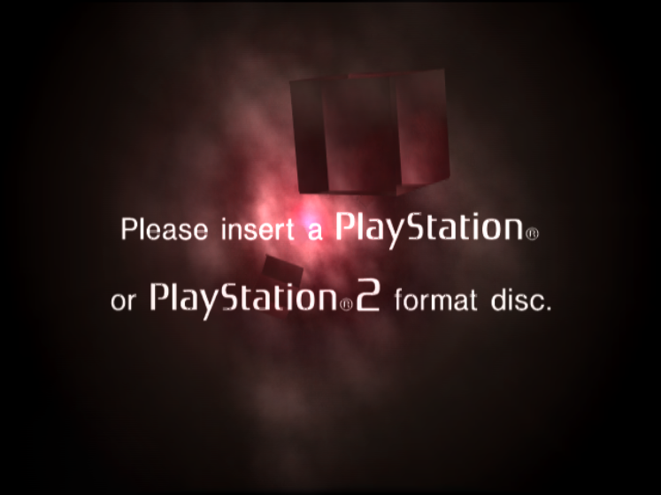
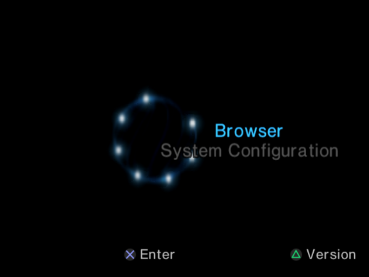
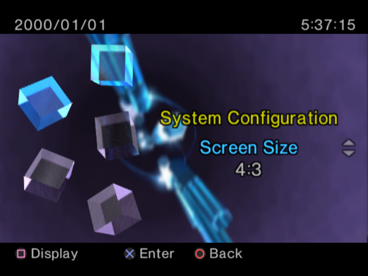
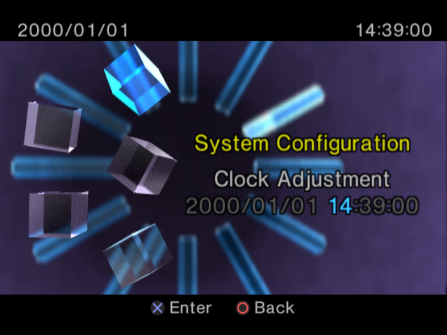

# osdbits-wasm — the OSDSYS opening in the browser

> A browser-native, persistent reconstruction of the PS2 OSDSYS opening and
> illegal-disc scenes: Rust → WebAssembly simulation, WebGPU rendering,
> IndexedDB persistence. No BIOS, no ROM, no emulator, no CLI.

**Status: experimental reconstruction. Not affiliated with Sony.** Nothing from
the console's firmware (textures, fonts, sound banks) is included; every texture
and sound is generated in your browser. See `docs/ASSET-POLICY.md`.

## Run it

```bash
# 1. toolchain (no rustup needed in this sandbox; CI uses dtolnay/rust-toolchain)
bash scripts/bootstrap-rust.sh

# 2. build the simulation core for wasm32 and copy it next to the app
bash scripts/build-wasm.sh

# 3. web app
cd web && npm install && npm run dev     # http://localhost:5173
```

Open the page and click **Start OSDSYS** once. That single gesture resumes the
`AudioContext`, initialises the renderer, loads the core and starts the opening
scene — no second button. Settings, scene choice and first-run state persist
across reloads (IndexedDB → localStorage → memory, reported honestly in the UI).

## What is implemented

| | |
|---|---|
| Mode A — opening / towers | Deterministic tower field, camera drift and fly-up, six additive fog layers, light streaks with 128-sample trails, refractive cubes |
| Mode B — idle | The tower field with no exit condition (indefinite) |
| Mode C — illegal disc | 128 red cloud particles, seven flare discs, lens sprites, fades, text overlay |
| Mode D — menu | Keyboard-accessible OSDSYS-*inspired* menu (explicitly **not** a browser/memory-card/game-list reconstruction) |
| Mode E — customisation | Scene, camera motion, speed, quality/resolution, fog/lights/cubes/text, audio, reduced motion, letterbox, seed, simulated hardware state, reset |
| Resilience | WebGPU → Canvas 2D fallback without reload; device-loss recovery; corrupt-settings recovery; explicit unsupported-browser messaging |

Every scene is driven by one deterministic simulation (`crates/osdbits-core`), so
the same seed and settings produce the same frames, and the frame hash shown in
Diagnostics changes only when the simulation does.

## Verify it

```bash
cd crates/osdbits-core && cargo test --offline          # 131 unit tests
cargo test --offline --test properties                  # 4 seeded campaigns
cargo clippy --offline --all-targets -- -D warnings
bash ../../scripts/build-wasm.sh && node ../../scripts/wasm-smoke.mjs
cd ../../web && npx tsc --noEmit && npx vitest run      # 56 tests (10 vs real wasm)
bash ../scripts/check-no-proprietary-assets.sh
bash ../scripts/check-upstream-untouched.sh
```

Exact commands, versions, outputs and the list of things that could **not** be
executed here (no browser binary, no GPU) are in `docs/TEST-EVIDENCE.md`. The
status vocabulary — Implemented / Tested / Verified / Approximate / Blocked /
Deferred — is used throughout `docs/LIMITATIONS.md` and `TODO.MD`.

## Documentation

`docs/ARCHITECTURE.md` · `docs/WASM-ABI.md` · `docs/PORTING-NOTES.md` ·
`docs/QA.md` · `docs/TEST-EVIDENCE.md` · `docs/LIMITATIONS.md` ·
`docs/ASSET-POLICY.md` · `TODO.MD` (phases, IDs, acceptance criteria, evidence).

---

The original PS2 reconstruction this fork builds on is preserved unchanged
(`scripts/check-upstream-untouched.sh` enforces that). Its documentation follows.

---

# OSDSYS reverse engineering

Reverse engineering of the PS2 OSDSYS — the boot ROM's on-screen display
(boot animation, browser, system configuration) — from a retail OSDSYS
image.



<table>
  <tr>
    <td align="center"><br><sub>illegal disc</sub></td>
    <td align="center"><br><sub>main menu</sub></td>
  </tr>
  <tr>
    <td align="center"><br><sub>system configuration</sub></td>
    <td align="center"><br><sub>clock adjustment</sub></td>
  </tr>
</table>

## Layout

- `osdbits/` — buildable reconstruction of the opening ("towers") boot
  animation as a standalone EE program.  Towers, fog, light streaks and
  the refractive cubes are ported and verified against the real ROM
  (GS-dump and savestate comparisons), running both under PCSX2 and on
  real hardware.
- `docs/` — analysis notes: `towers-analysis.md` is the full trace of the
  tower/cube pipeline (the lab notes behind the code), plus a structure
  report, menu rendering notes, and a cross-reference to the osdsys_re
  symbol database.
- `vucode_*` — the image's VU microcode: disassembly (`.vu`) and
  reconstructed dvp-as source (`.vsm`).
- `tools/` — resource extraction (see below).

## Building osdbits

The repo contains none of Sony's data.  The textures are extracted from
a PS2 BIOS image you dumped from your own console (the same file PCSX2
uses):

    python3 tools/extract-res.py path/to/bios.bin osdbits/res

Building requires the SCE PS2 EE toolchain (`ee-gcc`, `ee-dvp-as`) with
the SDK at `/usr/local/sce/ee`:

    cd osdbits
    make        # produces main.elf
    make run    # runs on a TOOL via dsedb

The ELF also runs under PCSX2.  Optional arguments
`main.elf [mode] [seed [ngames [nboots [framelimit]]]]`:

- `mode` — `boot` (default): the real boot sequence — camera drift,
  fly-up, "Sony Computer Entertainment" text, scene end; `idle`: stay
  over the tower field forever; `illegal`: the illegal-disc scene
  (red clouds, flare, cubes, "please insert a ... disc" text).
- the numeric args control the simulated memory-card boot history the
  tower field is generated from (`ngames 0` lights up the whole field;
  `framelimit` exits after N frames for scripted screenshots).

## Status

- Opening scene: towers, fog, light streaks, refractive cubes, the
  camera state machine (fly-up and scene end) and the "Sony Computer
  Entertainment" text overlay — done and verified.  A few small init
  helpers remain stubs (see `osdbits/opening.c`).
- Illegal-disc screen: ported (red cloud particles, the flare discs and
  lens sprites, the red glass cubes, localized text, screen fades) —
  not yet verified against the real ROM.
- Menu/browser: notes only, see `docs/menu-rendering-reverse.md`.
